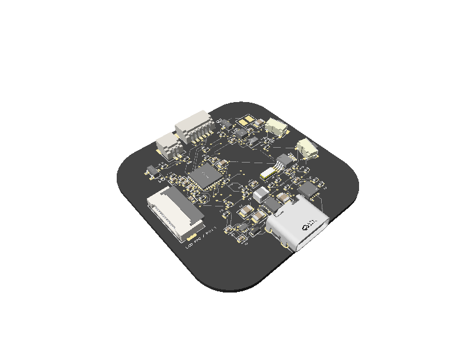

# SMARTWATCH V1 — STM32L432 wearable hardware

A complete four-layer tscircuit smartwatch PCB with a 40 x 40 mm rounded-square outline, 8 mm corner radius, top-side-only assembly, USB-C PD charging, a round color display, motion tracking, RTC, physical controls, haptics, SWD, and a protected 1-cell LiPo power path.



This repository is the hardware source of truth: schematic sheets, exact component models, placement, reviewed copper, strict checks, procurement files, and bring-up documentation are versioned together. Firmware and the enclosure remain separate deliverables.

## Board status

- 40 x 40 mm rounded-square PCB, 8 mm corner radius, 1 mm finished thickness, four copper layers.
- 59 fitted components and 42 named electrical nets.
- Every PCB component is on the top side; the bottom side contains copper only.
- 153 copper traces: 150 reviewed saved routes plus three explicit traces.
- Routed connectivity and DRC pass with zero reported warnings or errors.
- All 34 exact JLCPCB line items were live-stock checked for five boards on 2026-10-05.
- Schematic is split into six readable functional sheets.

These checks establish source consistency, not production certification. Gerber/DFM review, enclosure fit, flex orientation, power/thermal measurements, battery safety qualification, firmware bring-up, and a prototype build are still required before volume manufacture.

## Features

| Subsystem | Implementation |
| --- | --- |
| Controller | STM32L432KCU3, 80 MHz Cortex-M4F, 256 KB flash, 64 KB SRAM |
| Display | ER-TFT1.28-3, 1.28-inch 240 x 240 GC9A01A IPS panel over 4-wire SPI |
| Motion | Bosch BMA456 at I2C address `0x18`, with both interrupts routed |
| Timekeeping | PCF8563TS with FC-135 32.768 kHz crystal and battery-backed supply |
| Controls | Two active-low side buttons |
| Haptics | MOSFET-driven 12 mm coin vibration motor with flyback protection |
| USB-C PD | HUSB238 standalone sink, hardware-strapped to request 5 V / 1.25 A |
| Charging | BQ25180 charger and power path for a protected 1S LiPo |
| Main rail | TPS63802 buck-boost generating 3.3 V across the LiPo discharge curve |
| Debug | Keyed 6-pin JST-SH connector for SWDIO, SWCLK, NRST, BOOT0, 3V3 and GND |

V1 intentionally has no radio, GPS, NFC, touchscreen, audio, external flash, or dedicated fuel gauge. USB data pins are deliberately NC: the Type-C connection is power-only, while PD negotiation occurs on CC1/CC2.

## USB-C PD and power tree

```text
USB-C VBUS ── 10 Ω ──> HUSB238 VIN
     CC1/CC2 ─────────> HUSB238 PD negotiation
USB-C 5 V ── TVS ────> BQ25180 IN ──> SYS ──> TPS63802 ──> 3V3
                                      └──────> BAT <──── protected 1S LiPo
```

`R1=0 Ω` on VSET selects 5 V and `R2=0 Ω` on ISET selects 1.25 A. The fixed 5 V request keeps the BQ25180 input inside its intended USB supply range; higher PD voltages are not requested. `R18=10 Ω` and `C6=1 µF` implement the HUSB238 input filter. The BQ25180 still controls the actual battery charge and input limits, which firmware must configure for the qualified pack.

TPS63802 uses 510 kΩ / 91 kΩ feedback: `0.5 V × (1 + 510/91) ≈ 3.30 V`. `SYS` is not used directly as the digital rail because it can exceed 3.3 V.

## Schematic sheets

| Sheet | Contents |
| --- | --- |
| 1. USB-C PD & Battery Charging | Type-C receptacle, HUSB238, TVS, BQ25180, battery input and local filtering |
| 2. 3.3 V Buck-Boost Power | TPS63802, inductor, feedback and input/output capacitors |
| 3. Controller & Programming | STM32L432, decoupling, battery ADC, reset/BOOT0 and SWD |
| 4. Display & Backlight | 15-pin FPC, SPI/control nets and PWM low-side backlight driver |
| 5. Motion & RTC | BMA456, PCF8563, crystal, interrupts and local decoupling |
| 6. Buttons & Haptics | Side switches, pull-ups, motor driver, flyback diode and bulk capacitor |

Named nets carry signals between sheets; no long cross-sheet drawing wires are used. The checked-in schematic snapshot is the fastest visual review entry point.

## MCU pin map

| STM32 pin | Function |
| --- | --- |
| PA0 / PA1 | Buttons 1 / 2 |
| PA2 | Motor enable |
| PA3 | BQ25180 interrupt |
| PA4 / PA5 / PA7 | LCD CS / SCK / MOSI |
| PA6 | Battery ADC through 1 MΩ / 330 kΩ divider |
| PA8 / PA9 | BMA456 INT1 / INT2 |
| PA10 | RTC interrupt |
| PA11 | NC |
| PA13 / PA14 | SWDIO / SWCLK |
| PA15 | LCD backlight PWM |
| PB0 / PB1 | LCD D/C / reset |
| PB6 / PB7 | Shared I2C SCL / SDA |
| PH3 | BOOT0 with 100 kΩ pull-down |

A full 240 x 240 RGB565 framebuffer needs 115,200 bytes and does not fit in 64 KB SRAM. Firmware should render by tiles/lines or draw into the GC9A01A GRAM.

## Assembly and external parts

All SMT parts, connectors and switches are placed on the top/display side. No bottom-side assembly is permitted by the source checks.

- `LCD1` is the external no-touch ER-TFT1.28-3 module. Insert its flex into top-side `J4` and verify pin 1/contact orientation before power-up.
- `BT1` is an external protected 3.7 V, 400 mAh 1S LiPo with a correctly polarized JST-SH lead.
- `M1` is a wire-lead motor attached after SMT assembly; only its solder pads are represented on the PCB.
- The fixed 10 kΩ BQ25180 TS option does not provide battery-temperature monitoring. A production wearable should use a qualified NTC pack revision and complete charge/thermal testing.

See [assembly instructions](./docs/assembly.md) and [bring-up procedure](./docs/bring-up.md) before ordering or powering prototypes.

## Sourcing

Exact LCSC/JLCPCB part numbers are embedded in the circuit source and exported to [bom-jlcpcb.csv](./bom-jlcpcb.csv). The current [machine-readable stock audit](./sourcing/jlcpcb-stock-2026-10-05.json) covers 34 line items and 59 fitted components per board for a five-board build. Stock is not reserved; run `npm run check:stock` immediately before ordering. R4/C11616 and R5/C4147 had only a small margin during the recorded audit, so pre-order them or substitute only exact-value, 0402, 1% parts after rerunning all checks.

The LCD and battery are externally sourced and are not included in the 59 fitted PCB-component count. Replacement rules and limitations are in [sourcing/README.md](./sourcing/README.md).

## Build and verify

```sh
npm install
npm run verify
npm run check:stock
npm run snapshot:update
```

Useful commands:

| Command | Purpose |
| --- | --- |
| `npm run dev` | Open the routed design in the tscircuit development viewer |
| `npm run build:placement` | Build without saved routing for fast source/placement checks |
| `npm test` | Placement build plus strict connectivity, pin-map and outline assertions |
| `npm run build:routed` | Replay the reviewed route and require copper on every named net |
| `npm run check:routing` | Run routed DRC and verify four-layer copper usage |
| `npm run check:assembly` | Enforce top-side-only placement and exact JLC identifiers |
| `npm run check:decoupling` | Verify local decoupling distance for the six IC groups |
| `npm run check:stock` | Query live exact-part inventory from JLC Search |
| `npm run verify` | Run format, type, placement, routed, assembly and decoupling gates |

The saved-route input is fingerprinted. Any change to pads, connections, board outline, existing traces, or routing rules is rejected until a fresh route is reviewed and saved. See [routing/README.md](./routing/README.md).

## Repository layout

```text
SMARTWATCH_V1_STM32.circuit.tsx  complete board and six schematic sheets
index.circuit.tsx                project entry point
imports/                         exact reusable symbols, footprints and CAD metadata
routing/                         reviewed copper, repair and save tooling
scripts/                         electrical, routing, assembly, decoupling and stock gates
sourcing/                        dated live-stock evidence and replacement policy
docs/                            assembly and first-power bring-up procedures
__snapshots__/                   schematic, PCB, bottom-layer and 3D review artifacts
bom-jlcpcb.csv                   JLCPCB assembly upload BOM
bom.csv                          engineering procurement BOM
```

The detailed datasheet and pin/package verification record is in [REFERENCES.md](./REFERENCES.md).
